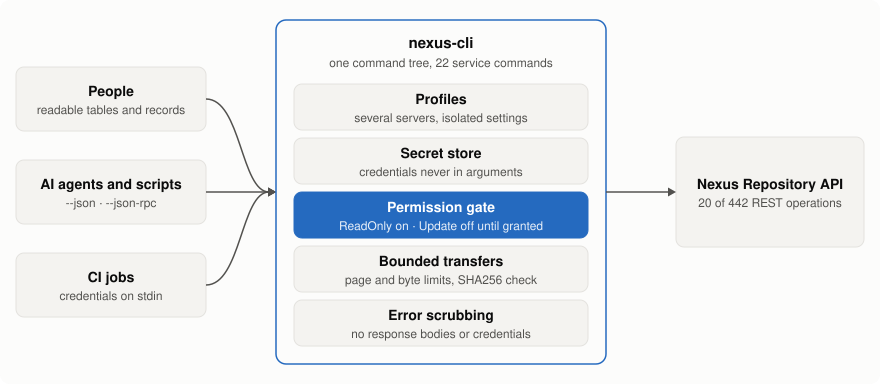
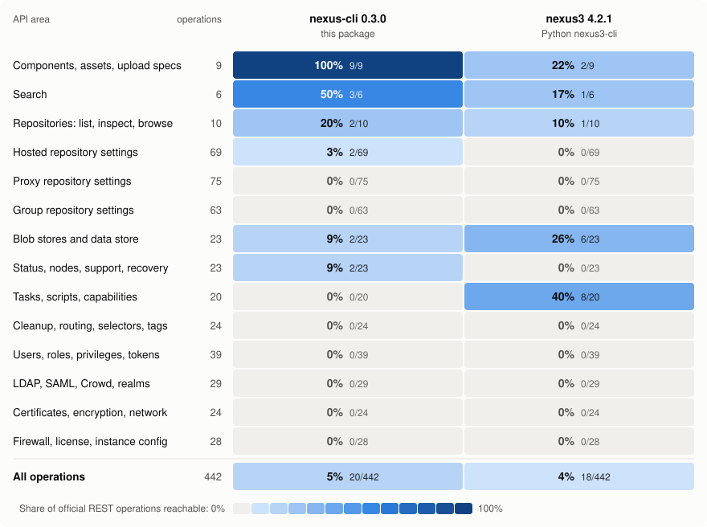

# nexus-cli

**Find, download and publish Sonatype Nexus Repository artifacts from one command-line tool that is safe to hand to an AI agent or a CI job.**

```sh
npm install --global @eyeauras/nexus-cli
nexus-cli profile configure lab --url https://nexus.example.test --credentials-stdin < credentials.json   # {"username":"...","password":"..."}
nexus-cli repositories list --profile lab
```

## Why

| | |
|---|---|
| **Artifact work, end to end** | Search with every query parameter of the pinned API (`--filter`), download by asset ID, search match or repository path, publish raw files and Maven artifacts (generated or original POM), delete by exact ID. |
| **Read-only by default** | A fresh profile can only read. Uploads, deletes and repository creation need `permissions grant Update` for that profile, and a delete also needs exact `--confirm-id` or `--confirm-name` confirmation. |
| **Safe transfers** | A download never overwrites an existing file, stops at 1 GiB unless `--max-bytes` says otherwise, and with `--sha256` the bytes are checked before the file appears. Uploads stream from disk. |
| **Cheap for agents** | `--json` everywhere, one bounded page per call (`--all` stops at 100 pages or 10,000 items and says where to resume), stable error codes, and a persistent `--json-rpc` session without restarting Node. |
| **No leaked secrets** | Profile credentials use stdin and the platform secret store; service mutations use finite JSON files, protected when sensitive. Secrets never enter command arguments. Errors never include response bodies. |
| **Predictable** | No automatic retries and no local guessing: the CLI never ranks versions or picks a search match for you, and an interrupted upload is reported as `nexus.mutation.outcomeUnknown`, not repeated. |

<picture>
  <source media="(prefers-color-scheme: dark)" srcset="docs/images/how-it-works-dark.svg">
  
</picture>

## Coverage

Share of the 442 REST operations in the pinned Nexus Repository 3.96.3-01 API description each
tool can call, by API area. Current nexus-cli source reaches 90 operations (20%), covering artifact transfers plus repository and security administration. This includes #677 changes; the package version remains 0.3.0.

<picture>
  <source media="(prefers-color-scheme: dark)" srcset="docs/images/coverage-matrix-dark.svg">
  
</picture>

Numbers, method and caveats: [coverage comparison](docs/coverage-comparison.md).

<!-- repository-coverage:start -->
| Format | Hosted | Proxy | Group | Total |
|---|---:|---:|---:|---:|
| cargo | 100% (3/3) | 100% (3/3) | 100% (3/3) | 100% (9/9) |
| docker | 100% (3/3) | 100% (3/3) | 100% (3/3) | 100% (9/9) |
| npm | 100% (3/3) | 100% (3/3) | 100% (3/3) | 100% (9/9) |
| nuget | 100% (3/3) | 100% (3/3) | 100% (3/3) | 100% (9/9) |
| raw | 67% (2/3) | 0% (0/3) | 0% (0/3) | 22% (2/9) |
| maven | 0% (0/3) | 0% (0/3) | 0% (0/3) | 0% (0/9) |

Other 20 formats: 0/153 format-specific operations. [Full per-format table and counting rules](docs/coverage-comparison.md#repository-format-coverage).

100% here means all pinned format-specific REST operations are reachable, not every setting,
edition or native-client workflow. Common list/get/delete, security and content transfers are
counted separately; Maven transfers work even though Maven-specific administration is 0%.
<!-- repository-coverage:end -->

## Use it

```sh
# read: find assets, get JSON
nexus-cli search assets --repository releases --name widget --json --profile lab

# write: allow it for this profile once, then publish
nexus-cli permissions grant Update --profile lab
nexus-cli components upload raw --repository raw-releases --directory builds/1.0 --filename widget.zip --file widget.zip --profile lab

# discover: every level has help
nexus-cli --help
nexus-cli components upload --help
```

Needs Node.js 22+ and a working platform secret store for Basic credentials. Offline tests use
the Nexus 3.96.3-01 API description; no live Nexus version or edition is certified, and your
account's server privileges still decide what a call is allowed to do.

## CI artifact roundtrip

Upload one file to an existing raw hosted repository, download it back with a checksum and compare.
The package smoke runs this exact recipe offline; its conditions are in the
[reference](docs/reference.md#ci-artifact-roundtrip).

```bash
set -euo pipefail
set +x
: "${NEXUS_URL:?}" "${REPOSITORY:?}" "${SOURCE:?}" "${DESTINATION:?}"
nexus-cli profile create ci --json
# Feed a JSON {"username":"...","password":"..."} object from your CI secret
# provider on stdin. This example reads the already protected CREDENTIALS_JSON file.
: "${CREDENTIALS_JSON:?}"
nexus-cli profile configure ci --url "$NEXUS_URL" --auth-mode basic \
  --credentials-stdin --profile ci --json < "$CREDENTIALS_JSON"
trap 'nexus-cli auth logout --profile ci --json >/dev/null' EXIT
nexus-cli permissions grant Update --profile ci --json
sha=$(node --input-type=module -e 'import {readFileSync} from "node:fs"; import {createHash} from "node:crypto"; console.log(createHash("sha256").update(readFileSync(process.argv[1])).digest("hex"))' "$SOURCE")
nexus-cli components upload raw --repository "$REPOSITORY" --directory ci \
  --filename artifact.bin --file "$SOURCE" --profile ci --json
nexus-cli content download --repository "$REPOSITORY" --path ci/artifact.bin \
  --output "$DESTINATION" --sha256 "$sha" --profile ci --json
node --input-type=module -e 'import {readFileSync} from "node:fs"; import assert from "node:assert/strict"; assert.deepEqual(readFileSync(process.argv[1]), readFileSync(process.argv[2]))' "$SOURCE" "$DESTINATION"
```

## More

- [Command reference](docs/reference.md): credentials, paging, search filters, downloads, uploads, discovery, error codes.
- [Coverage comparison](docs/coverage-comparison.md) and the [operation inventory](docs/api/inventory.md).
- [Product contract](docs/product-contract.md), [stories](docs/stories.md) and [source contracts](docs/source-contracts.md).
- [Release guide](docs/release.md). Built on `@eyeauras/cli-factory`.

## Distribution administration

Manage Cargo, NuGet, npm and Docker hosted/proxy/group repositories and Nexus security.
See [repository administration](docs/distribution-administration.md), [security administration](docs/security-administration.md),
[the 28-repository recipe](docs/distribution-reconfiguration.md), and [protected NuGet key handoff](docs/nuget-key-protocol.md).
NuGet self-key reauthentication is offline source-qualified; live qualification remains unresolved.

Inspect outbound HTTP settings with `system http get`. Delete a repository with
`repositories delete <name> --confirm-name <name>` after inspecting references using
`repositories list --include-group-members`. These operations follow the same profile and permission gates.
